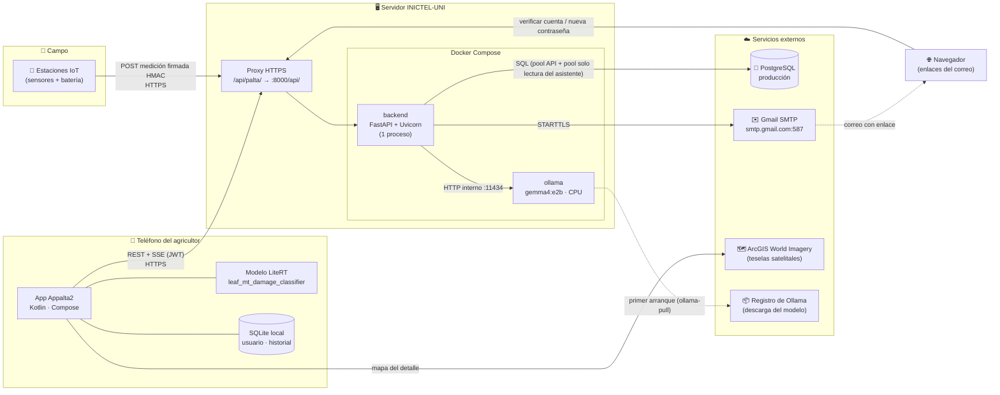
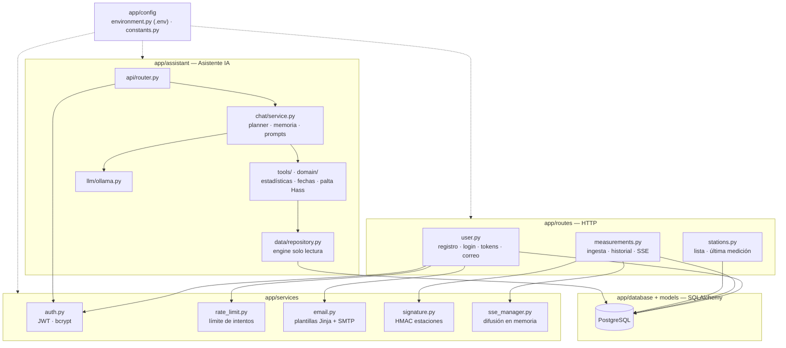
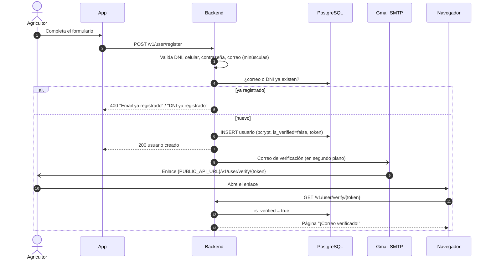
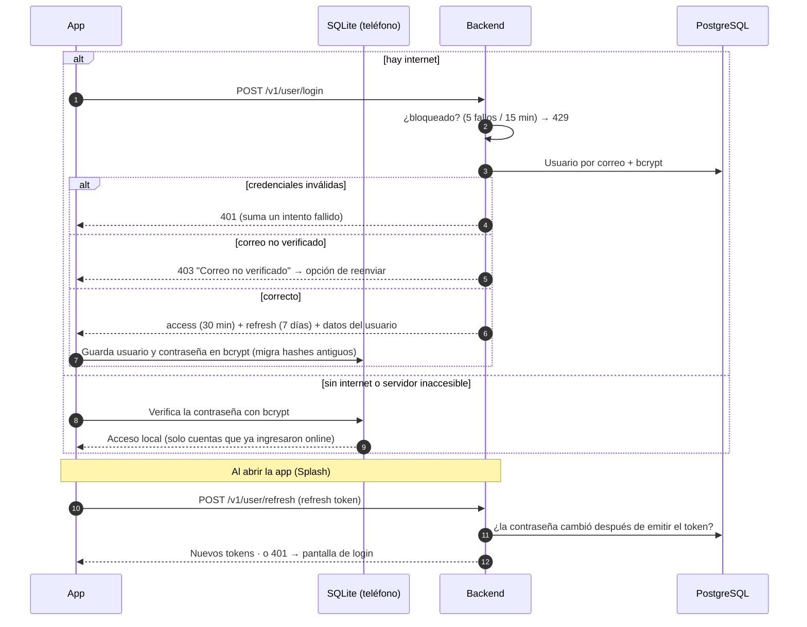
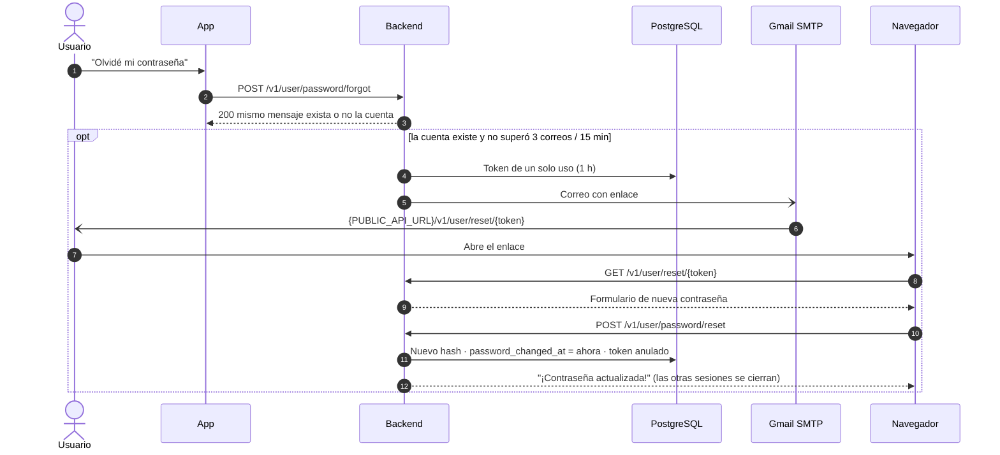
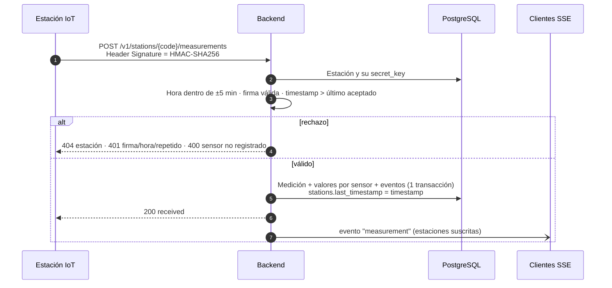
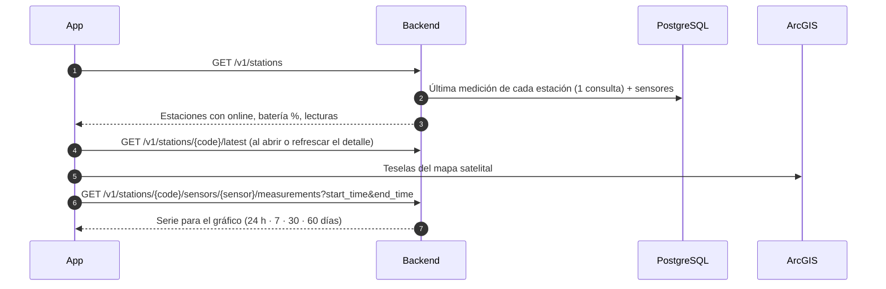
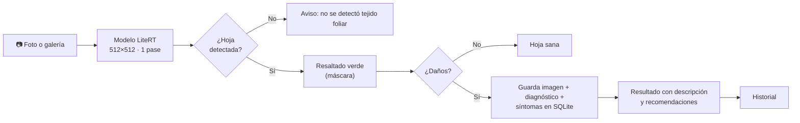
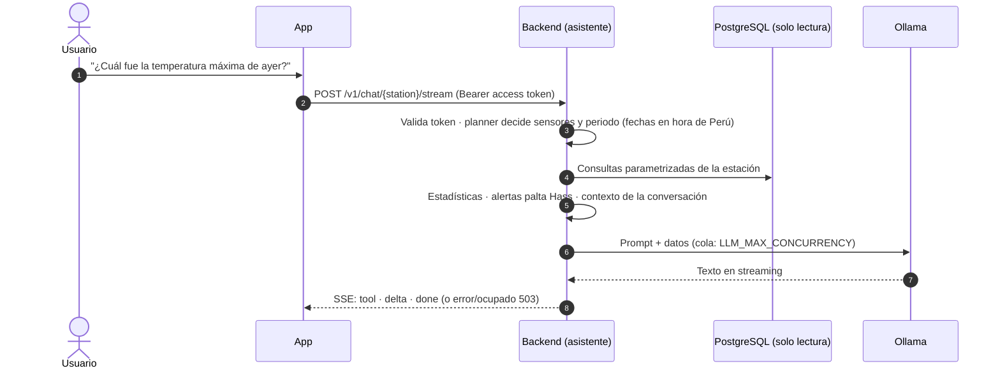
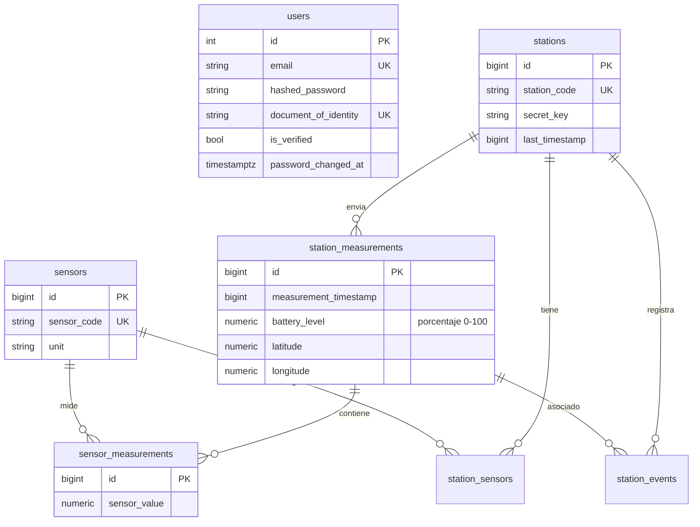

# Appalta2 — Documentación del sistema y despliegue a producción

> Desarrollado por **[velardesoft](https://github.com/velardesoft)** · Licencia [MIT](LICENSE)

Este documento describe **qué hace el sistema**, **cómo se conectan sus piezas** (incluidos los
sistemas externos) y **cómo desplegarlo y operarlo en producción**.

| Repositorio | Contenido |
|---|---|
| `appalta2-backend` (este) | API FastAPI, asistente IA, migraciones SQL, Docker |
| `appalta2` | App Android (Kotlin + Jetpack Compose) |

---

## Índice

1. [Funcionalidades](#1-funcionalidades)
2. [Arquitectura y sistemas externos](#2-arquitectura-y-sistemas-externos)
3. [Flujos del sistema](#3-flujos-del-sistema)
4. [API REST](#4-api-rest)
5. [Modelo de datos](#5-modelo-de-datos)
6. [Seguridad](#6-seguridad)
7. [Configuración (variables de entorno)](#7-configuración-variables-de-entorno)
8. [Primer despliegue](#8-primer-despliegue)
9. [Actualizar una versión](#9-actualizar-una-versión)
10. [Operación](#10-operación)
11. [Publicar la app Android](#11-publicar-la-app-android)
12. [Checklist de primera producción](#12-checklist-de-primera-producción)

---

## 1. Funcionalidades

### Usuarios y acceso
- **Registro** con correo, contraseña segura (8+ caracteres con mayúsculas, minúsculas, números y
  un símbolo), nombres, DNI (8 dígitos, único) y celular (9 dígitos).
- **Verificación de correo**: enlace enviado por correo; sin verificar no se puede ingresar.
- **Inicio de sesión** con JWT: *access token* (30 min) y *refresh token* (7 días), cada uno solo
  válido para su uso. La app renueva la sesión al abrirse.
- **Recuperación de contraseña** por enlace de un solo uso (1 h) que abre una página web.
  Cambiar la contraseña cierra las sesiones abiertas en otros dispositivos.
- **Protección**: 5 intentos fallidos de login por correo bloquean 15 min; máximo 3 correos por
  dirección cada 15 min; respuestas que no revelan qué correos están registrados.
- **Acceso sin conexión** en la app: tras un primer login online, el usuario puede ingresar sin
  internet (contraseña guardada con bcrypt en el teléfono).

### Diagnóstico de hojas de palta (en el teléfono)
- Foto con la cámara o desde la galería, con **guía** de cómo encuadrar la hoja.
- **Modelo de IA multitarea** (LiteRT, sin internet): segmenta la hoja (resaltado verde) y detecta
  daños/plagas (arañita roja, mosca blanca, queresas).
- Resultado con descripción y recomendaciones de manejo; **historial** de diagnósticos guardado
  en el teléfono (SQLite).

### Estaciones agrometeorológicas
- Cada estación (IoT) envía cada ~10 min sus lecturas **firmadas con HMAC-SHA256**: temperatura y
  humedad del aire, presión atmosférica, temperatura, humedad y pH del suelo, y **batería en %**.
- La API valida firma, hora y orden (anti-replay) y guarda medición + eventos en una transacción.
- **App**: lista de estaciones (en línea si reportó en las últimas 24 h), detalle con mapa
  satelital, últimas lecturas, batería y **gráficos históricos** por sensor (24 h a 60 días).
- **Tiempo real**: `/stations/stream` difunde cada medición nueva por Server-Sent Events.

### Asistente IA por estación (AgriSense)
- Chat en lenguaje natural sobre los datos de **la estación seleccionada** ("¿cuál fue la
  temperatura máxima de ayer?", "¿cómo están mis paltas?").
- El código (no el modelo) consulta la BD, calcula estadísticas y fechas, y evalúa alertas para
  la palta Hass; el modelo de lenguaje (Ollama, en CPU) redacta la respuesta en streaming.
- Consultas rápidas ("/ahora", "/temp-suelo ayer"). Nunca da recomendaciones agronómicas.
  Detalle: [`app/assistant/README.md`](app/assistant/README.md).

---

## 2. Arquitectura y sistemas externos



| Sistema | Rol | Protocolo | Configuración |
|---|---|---|---|
| **App Android** | Cliente de usuarios; diagnóstico local | HTTPS REST/SSE | `API_BASE_URL` en `.env.production` de la app |
| **Estaciones IoT** | Envían mediciones | HTTPS + firma HMAC | `stations.secret_key` en la BD |
| **Proxy HTTPS** (servidor) | TLS y ruta pública `/api/palta/` | HTTPS → HTTP | Fuera de este repo |
| **backend** (Docker) | API, validación, persistencia, asistente | HTTP :8000 | `.env.production` |
| **ollama** (Docker) | Modelo de lenguaje en CPU | HTTP interno | `LLM_*` |
| **PostgreSQL** | Datos de usuarios y estaciones | TCP 5432 | `DATABASE_URL` |
| **Gmail SMTP** | Correos de verificación y recuperación | SMTP 587 STARTTLS | `MAIL_*` |
| **ArcGIS World Imagery** | Mapa satelital en la app | HTTPS | Sin clave |
| **Registro de Ollama** | Descarga inicial del modelo (~7 GB) | HTTPS | `LLM_MODEL` |

### Componentes internos del backend



---

## 3. Flujos del sistema

### 3.1 Registro y verificación de correo



### 3.2 Inicio de sesión, renovación y acceso sin conexión



### 3.3 Recuperación de contraseña



### 3.4 Ingesta de mediciones de una estación



Mensaje firmado (debe coincidir byte a byte con el firmware):

```
{station_code}|{timestamp}|{battery_level}|{sensor_1}|{valor_1}|{sensor_2}|{valor_2}...
```

Números sin ceros a la derecha (`6.20` → `6.2`, `4.0` → `4.0`) y `NA` si falta el valor.

### 3.5 Consulta de estaciones en la app



### 3.6 Diagnóstico de una hoja (100 % en el teléfono)



No usa el backend ni internet: funciona en el campo sin señal.

### 3.7 Asistente IA (chat por estación)



---

## 4. API REST

Base local `http://localhost:8000/api/v1` · Producción `https://proyectos-didt.inictel-uni.edu.pe/api/palta/v1`.
Swagger en `/docs` solo en desarrollo (o con `API_DOCS_ENABLED=true`).

| Método | Ruta | Autenticación | Descripción |
|---|---|---|---|
| GET | `/` | — | Estado del servicio (healthcheck) |
| POST | `/user/register` | — | Registro (envía correo de verificación) |
| GET | `/user/verify/{token}` | — | Página de verificación |
| POST | `/user/resend-verification` | — | Reenvía verificación (respuesta neutra) |
| POST | `/user/login` | — | Tokens + datos del usuario |
| POST | `/user/refresh` | refresh token | Renueva la sesión |
| GET | `/user/me` | Bearer | Usuario actual |
| POST | `/user/password/forgot` | — | Correo de recuperación (respuesta neutra) |
| GET | `/user/reset/{token}` | — | Formulario web de nueva contraseña |
| POST | `/user/password/reset` | token del correo | Cambia la contraseña |
| POST | `/stations/{code}/measurements` | Firma HMAC | Ingesta de una estación |
| GET | `/stations` | — | Estaciones con su última medición |
| GET | `/stations/{code}/latest` | — | Última medición de una estación |
| GET | `/stations/{code}/sensors/{sensor}/measurements` | — | Historial (`start_time`, `end_time`, `limit`) |
| GET | `/stations/stream?stations=A,B` | — | Mediciones en tiempo real (SSE) |
| POST | `/chat/{code}` · `/chat/{code}/stream` | Bearer | Asistente IA |
| GET | `/chat/{code}/commands` | Bearer | Consultas rápidas |
| DELETE | `/chat/{code}/sessions/{id}` | Bearer | Reinicia la conversación |
| GET | `/assistant/health` | — | BD y modelo disponibles |

Errores: `{"detail": "mensaje"}`; validación (422): `{"detail": [{"msg": "..."}]}`.

---

## 5. Modelo de datos



**Migraciones** (`sql/`): se aplican en orden con `python -m scripts.setup_db`, que registra cada
una en `schema_migrations` y solo ejecuta las pendientes. En una base creada antes de este
control, registra el esquema inicial (`001`–`005`) sin volver a ejecutarlo.

| Script | Contenido |
|---|---|
| `001`–`005` | Esquema, índices, sensores, estaciones de ejemplo (claves aleatorias) |
| `006_users_unique_dni.sql` | DNI único |
| `007_users_session_security.sql` | `password_changed_at` e índice `lower(email)` |

Nuevas migraciones: agregar `sql/008_descripcion.sql` (se aplica una sola vez).

---

## 6. Seguridad

| Tema | Medida |
|---|---|
| Contraseñas | bcrypt en el servidor y en el teléfono; política de complejidad en ambos |
| Sesiones | JWT HS256 con tipo (access/refresh) e `iat`; cambio de contraseña invalida refresh tokens |
| Fuerza bruta | 5 logins fallidos / 15 min; 3 correos / 15 min por dirección |
| Enumeración de cuentas | Respuestas neutras en recuperación y reenvío; login de tiempo constante |
| Estaciones | HMAC-SHA256 por estación, ventana de ±5 min y anti-replay |
| Asistente | Engine de solo lectura con `statement_timeout`; la estación sale de la URL, no del modelo |
| Transporte | HTTPS en producción; la app release rechaza HTTP |
| Configuración | `APP_ENV=production` exige `JWT_SECRET_KEY` segura y rechaza valores `REEMPLAZAR_…` |
| Contenedor | Usuario sin privilegios; Ollama sin puerto expuesto |
| Datos del teléfono | Los tokens no se incluyen en el respaldo en la nube de Android |

---

## 7. Configuración (variables de entorno)

Tres archivos, mismo esquema en backend y app:

| Archivo | Uso | En git |
|---|---|---|
| `.env.example` | Plantilla única y documentada (`[PROD]` = valor de producción) | Sí |
| `.env` | Desarrollo local | No |
| `.env.production` | Servidor (`docker compose --env-file .env.production`) | No |

```bash
cp .env.example .env.production                    # 1. crear
# 2. reemplazar cada REEMPLAZAR_… y aplicar los valores [PROD]
python -c "import secrets; print(secrets.token_urlsafe(48))"   # JWT_SECRET_KEY
python -m scripts.check_env .env.production        # 3. verificar (no muestra secretos)
python -m scripts.check_env .env.production --connect   # opcional: prueba BD y SMTP
```

| Variable | Obligatoria | Producción |
|---|---|---|
| `APP_ENV` | — | `production` |
| `PUBLIC_API_URL` | — | `https://proyectos-didt.inictel-uni.edu.pe/api/palta` |
| `DATABASE_URL` | Sí | `postgresql+psycopg2://…@host.docker.internal:5432/appalta2` |
| `JWT_SECRET_KEY` | En producción | 48+ caracteres aleatorios |
| `MAIL_USERNAME` / `MAIL_PASSWORD` | Para enviar correos | Cuenta Gmail + contraseña de aplicación (16) |
| `API_DOCS_ENABLED` | — | vacío (Swagger cerrado) |
| `LLM_MODEL`, `LLM_MAX_CONCURRENCY` | — | `gemma4:e2b`, `2` |
| `BACKEND_PORT` | — | `8000` (solo Docker Compose) |

Lista completa y valores por defecto: [`.env.example`](.env.example) y `app/config/environment.py`.
Nombres antiguos (`BACKEND_URL`, `SECRET_KEY`, `USE_CREDENTIALS`, …) se aceptan con aviso en el log.

---

## 8. Primer despliegue

**Requisitos del servidor**: Docker + Docker Compose · RAM ≥ 12 GB (el modelo ocupa ~7 GB) ·
~10 GB de disco libre · acceso a PostgreSQL · salida a `smtp.gmail.com:587` · proxy HTTPS que
publique `/api/palta/` hacia `http://127.0.0.1:${BACKEND_PORT}/api/` **sin buffering** (para el
streaming del chat y de `/stations/stream`).

```bash
# 1. Código
git clone https://github.com/pdsiia-inictel-uni/appalta2-backend.git && cd appalta2-backend

# 2. Respaldo de la base
pg_dump -Fc -f appalta2_$(date +%F).dump appalta2

# 3. DNI duplicados (la migración 006 falla si hay): debe devolver 0 filas
psql "$DATABASE_URL" -c "SELECT document_of_identity, count(*) FROM users GROUP BY 1 HAVING count(*) > 1;"

# 4. Configuración
cp .env.example .env.production && nano .env.production
docker compose --env-file .env.production run --rm backend python -m scripts.check_env -

# 5. Migraciones
docker compose --env-file .env.production run --rm backend python -m scripts.setup_db

# 6. Levantar
docker compose --env-file .env.production up -d --build
docker compose logs -f ollama-pull          # primera vez: descarga ~7 GB, termina con "success"
```

> Dentro del contenedor no existe el archivo: `check_env -` y `setup_db` leen las variables que Docker Compose inyecta
> desde `.env.production` (`env_file`).

**Verificar**:

```bash
curl https://proyectos-didt.inictel-uni.edu.pe/api/palta/v1/                  # {"status":"running"}
curl https://proyectos-didt.inictel-uni.edu.pe/api/palta/v1/assistant/health  # database y model true
docker compose exec backend python -m scripts.assistant.run_eval              # ≥ 95 % de aciertos
```

Prueba de punta a punta: registrar un usuario desde la app release → abrir el enlace del correo →
iniciar sesión → abrir una estación → preguntar al asistente.

---

## 9. Actualizar una versión

```bash
git pull
docker compose --env-file .env.production run --rm backend python -m scripts.setup_db   # migraciones pendientes
docker compose --env-file .env.production up -d --build backend
```

Las conversaciones del chat en curso se reinician (la memoria vive en el proceso).

**Volver atrás**: `git checkout <versión anterior>` y repetir el `up -d --build backend`. Las
migraciones `006` y `007` son compatibles con versiones anteriores.

---

## 10. Operación

| Tarea | Comando |
|---|---|
| Estado | `docker compose ps` (el backend tiene healthcheck) |
| Logs | `docker compose logs -f backend` (rotan a 5 × 20 MB) |
| Migraciones pendientes | `docker compose run --rm backend python -m scripts.setup_db --check` |
| Revisar configuración | `docker compose run --rm backend python -m scripts.check_env -` |
| Evaluación mensual del asistente | `docker compose exec backend python -m scripts.assistant.run_eval` |
| Respaldo diario de la BD | `pg_dump -Fc -f appalta2_$(date +%F).dump appalta2` (programar con cron) |

**Escalar**: la API corre con **1 worker** porque la memoria del chat, los clientes SSE y el
límite de intentos viven en el proceso. Para varios workers o réplicas, mover esas tres piezas a
Redis (store de conversaciones, Pub/Sub de mediciones y contadores). Lo demás no guarda estado;
el pool de BD se ajusta con `DB_POOL_SIZE` / `DB_MAX_OVERFLOW`.

---

## 11. Publicar la app Android

En el repositorio `appalta2`:

```bash
cp .env.example .env.production
# API_BASE_URL=https://proyectos-didt.inictel-uni.edu.pe/api/palta/
# RELEASE_KEYSTORE_FILE, RELEASE_KEYSTORE_PASSWORD, RELEASE_KEY_ALIAS, RELEASE_KEY_PASSWORD

# Keystore (UNA vez; guardarlo con respaldo fuera del repo: sin él no se puede actualizar la app)
keytool -genkeypair -v -keystore appalta2-release.jks -alias appalta2 -keyalg RSA -keysize 4096 -validity 10000

./gradlew bundleRelease     # AAB para Play Store: app/build/outputs/bundle/release/
./gradlew assembleRelease   # APK firmado para instalar directo: app/build/outputs/apk/release/
```

Antes de cada publicación: subir `versionCode` (y `versionName`) en `app/build.gradle.kts` y
verificar que `app/src/main/assets/leaf_mt_damage_classifier.tflite` esté presente.

---

## 12. Checklist de primera producción

**Backend**
- [ ] Respaldo de la BD tomado
- [ ] `.env.production` sin `REEMPLAZAR_…`: `check_env` sin errores ni avisos
- [ ] `APP_ENV=production` y `JWT_SECRET_KEY` aleatoria (48+)
- [ ] `PUBLIC_API_URL` es la URL pública `https://` (los enlaces de los correos la usan)
- [ ] Gmail con contraseña de aplicación (16 caracteres); `check_env --connect` OK
- [ ] `setup_db --check` sin pendientes
- [ ] Proxy HTTPS con buffering desactivado para `/stream`
- [ ] Healthchecks OK y `run_eval` ≥ 95 %
- [ ] Respaldo diario de la BD programado

**App**
- [ ] Modelo `leaf_mt_damage_classifier.tflite` en `app/src/main/assets/`
- [ ] `.env.production` con la URL `https://` y la firma configurada
- [ ] Keystore respaldado fuera del repositorio
- [ ] `versionCode` incrementado
- [ ] Prueba en teléfono real: registro → correo → login → estaciones → chat → diagnóstico

---

Desarrollado por **[velardesoft](https://github.com/velardesoft)**.
