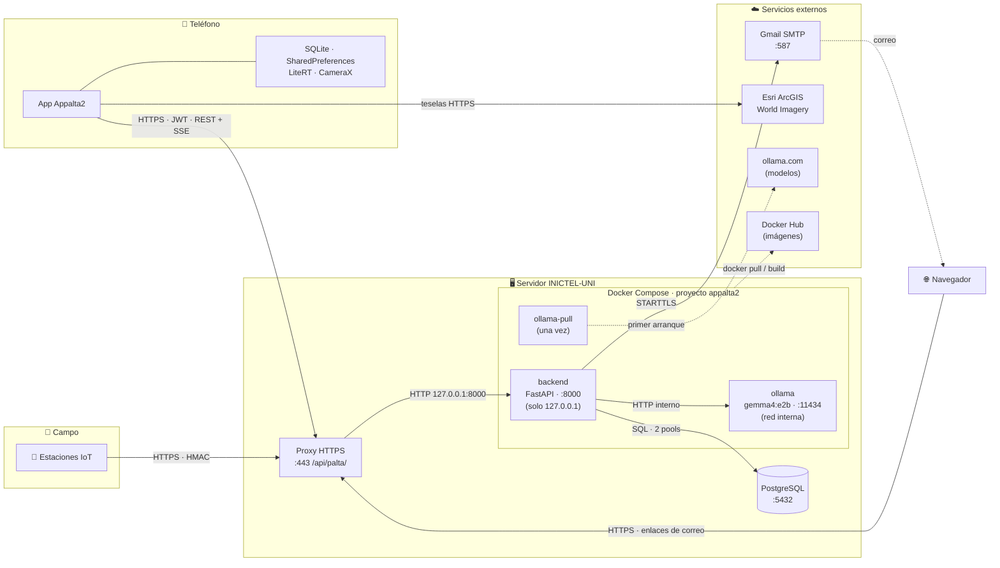

# Appalta2 — Servicios internos y externos

> Desarrollado por el **equipo de [INICTEL-UNI](https://github.com/pdsiia-inictel-uni)** · Licencia [MIT](LICENSE)

Inventario de **todos los servicios** de los que depende Appalta2 (backend y app Android): qué hace
cada uno, quién lo usa, cómo se configura, cómo saber si está sano y **qué pasa cuando falla**.
El despliegue paso a paso está en [DEPLOY.md](DEPLOY.md).

---

## Índice

1. [Mapa general](#1-mapa-general)
2. [Resumen](#2-resumen)
3. [Servicios internos del servidor](#3-servicios-internos-del-servidor)
4. [Servicios externos](#4-servicios-externos)
5. [Clientes y dispositivos](#5-clientes-y-dispositivos)
6. [Red y puertos](#6-red-y-puertos)
7. [Estado en memoria y escalamiento (Redis)](#7-estado-en-memoria-y-escalamiento-redis)
8. [Matriz de fallas](#8-matriz-de-fallas)
9. [Monitoreo](#9-monitoreo)
10. [Servicios que no se usan](#10-servicios-que-no-se-usan)

---

## 1. Mapa general



**Fronteras de confianza**

| Frontera | Cómo se protege |
|---|---|
| Internet → servidor | Solo el proxy HTTPS (443) es público. La API escucha en `127.0.0.1` y Ollama no publica puerto. |
| Estación → API | Firma HMAC-SHA256 por estación, ventana de hora ±5 min y anti-replay. |
| App → API | JWT (access 30 min / refresh 7 días) sobre HTTPS; la app release rechaza HTTP. |
| API → PostgreSQL | Usuario propio; el asistente usa sesiones de **solo lectura** con `statement_timeout`. |
| API → Ollama | Red interna de Docker; el modelo solo recibe datos ya consultados, nunca acceso a la BD. |

---

## 2. Resumen

| # | Servicio | Tipo | Lo usa | Protocolo / puerto | ¿Crítico? | Configuración |
|---|---|---|---|---|---|---|
| 1 | **API backend** (FastAPI) | Interno | App, estaciones, navegador | HTTP :8000 (detrás del proxy) | Sí | `.env.production` |
| 2 | **PostgreSQL** | Interno | API, asistente, migraciones | TCP :5432 | Sí | `DATABASE_URL` |
| 3 | **Ollama** + `gemma4:e2b` | Interno | Asistente IA | HTTP :11434 (interno) | Solo el chat | `LLM_*` |
| 4 | **ollama-pull** | Interno (tarea) | Despliegue | — | Solo la 1.ª vez | `LLM_MODEL` |
| 5 | **Proxy HTTPS** | Interno (TI) | Todo el tráfico público | HTTPS :443 | Sí | Fuera del repo ([§3.5](#35-proxy-https)) |
| 6 | **Gmail SMTP** | Externo | Registro y recuperación | SMTP :587 STARTTLS | Para cuentas nuevas | `MAIL_*` |
| 7 | **Esri ArcGIS World Imagery** | Externo | App (mapa) | HTTPS :443 | No | URL fija en la app |
| 8 | **Docker Hub** | Externo | Build y despliegue | HTTPS | Solo al desplegar | `Dockerfile`, compose |
| 9 | **Registro de Ollama** | Externo | `ollama-pull` | HTTPS | Solo la 1.ª vez | `LLM_MODEL` |
| 10 | **PyPI · Google Maven · Maven Central** | Externo | Build de imagen y APK | HTTPS | Solo al compilar | `requirements.txt`, Gradle |
| 11 | **GitHub** | Externo | Código fuente | HTTPS / SSH | Solo al desplegar | — |
| 12 | **Estaciones IoT** | Cliente | — | HTTPS → API | Fuente de datos | `stations.secret_key` |
| 13 | **App Android** | Cliente | Usuarios | HTTPS → API | — | `API_BASE_URL` |

---

## 3. Servicios internos del servidor

### 3.1 API backend (FastAPI)

| | |
|---|---|
| **Qué hace** | Usuarios y sesiones, ingesta de estaciones, consultas e historial, tiempo real (SSE), páginas web de verificación/recuperación y el asistente IA. |
| **Imagen** | `appalta2-backend:1.0.0` (`Dockerfile`, Python 3.11.17 slim, ~380 MB) |
| **Contenedor** | `appalta2-backend` · usuario `appuser` (uid 10001) · sistema de archivos de solo lectura · sin capacidades Linux · máx. 1 GB de RAM |
| **Proceso** | `uvicorn` con **1 worker** (ver [§7](#7-estado-en-memoria-y-escalamiento-redis)) |
| **Puerto** | `127.0.0.1:${BACKEND_PORT:-8000}` → `:8000` |
| **Arranque** | `docker-entrypoint.sh` aplica las migraciones pendientes (`MIGRATE_ON_START=true`) y luego inicia uvicorn |
| **Salud** | `GET /api/v1/` → `{"status":"running"}` (healthcheck de Docker cada 30 s) |
| **Logs** | stdout → `docker compose logs backend` (rotan a 5 × 20 MB) |

**Módulos internos**

| Módulo | Archivo | Responsabilidad | ¿Guarda estado? |
|---|---|---|---|
| Configuración | `app/config/environment.py` | Lee y valida variables; en producción exige `JWT_SECRET_KEY` segura y rechaza `REEMPLAZAR_…` | No |
| Autenticación | `app/services/auth.py` | bcrypt, JWT con tipo `access`/`refresh` e `iat` | No |
| Límite de intentos | `app/services/rate_limit.py` | 5 logins fallidos / 15 min por correo; 3 correos / 15 min por dirección | **Memoria** |
| Correo | `app/services/email.py` | Plantillas Jinja (`app/templates/email/`) + envío SMTP en segundo plano | No |
| Firma de estaciones | `app/services/signature.py` | Verifica HMAC-SHA256 | No |
| Tiempo real | `app/services/sse_manager.py` | Difunde mediciones a clientes SSE (cola de 100 eventos por cliente) | **Memoria** |
| Datos | `app/database/` | Consultas SQLAlchemy (pool `appalta2-api`) | No |
| Asistente IA | `app/assistant/` | Planner, herramientas de datos, cliente Ollama, historial del chat | **Memoria** (historial) |
| Migraciones | `scripts/setup_db.py` | Aplica `sql/NNN_*.sql` pendientes y los registra en `schema_migrations` | En la BD |
| Diagnóstico de config. | `scripts/check_env.py` | Valida `.env*` sin mostrar secretos; `--connect` prueba BD y SMTP | No |

**Si falla**: la app no puede iniciar sesión online (usa el acceso local sin conexión), las estaciones
no pueden entregar datos (reintentan según su firmware) y el chat no responde. El diagnóstico de
hojas sigue funcionando porque corre en el teléfono.

---

### 3.2 PostgreSQL

| | |
|---|---|
| **Qué hace** | Guarda usuarios, estaciones, sensores, mediciones, eventos y el control de migraciones. |
| **Dónde** | **Producción**: la base existente del servidor (no está en este compose). **Desarrollo**: el PostgreSQL instalado en la PC (puerto 5432). |
| **Versión** | 14 o superior (desarrollo: 17) |
| **Conexión** | `DATABASE_URL` · `postgresql+psycopg2://…` en Linux/Docker, `postgresql+pg8000://…` en Windows |
| **Extensiones** | `pgcrypto` (claves aleatorias de estaciones). pgvector **no** se usa. |

**Conexiones que abre el backend** (visibles en `pg_stat_activity.application_name`):

| Pool | `application_name` | Tamaño | Permisos | Para qué |
|---|---|---|---|---|
| API | `appalta2-api` | `DB_POOL_SIZE` 10 + `DB_MAX_OVERFLOW` 20 | Lectura y escritura | Usuarios, ingesta, consultas |
| Asistente | `appalta2-assistant` | 3 + 2 | **Solo lectura**, `statement_timeout` 5 s | Consultas del chat |
| Migraciones | `appalta2-migrations` | 1 (temporal) | DDL | `setup_db` al arrancar |

Máximo simultáneo: **~36 conexiones**. Verificar que `max_connections` del servidor lo permita
junto con las demás aplicaciones.

**Tablas**: `users`, `stations`, `sensors`, `station_sensors`, `station_measurements`,
`sensor_measurements`, `station_events`, `schema_migrations`. Modelo completo en
[DEPLOY.md §5](DEPLOY.md#5-modelo-de-datos).

**Respaldo**: `pg_dump -Fc` diario (programado con cron). Las conexiones cortadas se descartan solas
(`pool_pre_ping`) y se renuevan cada 30 min (`pool_recycle`).

**Si falla**: la API responde 500 en todo lo que lee o escribe datos; `/api/v1/assistant/health`
informa `database: false`. Al volver PostgreSQL, la API se recupera sin reiniciarse.

---

### 3.3 Ollama (modelo de lenguaje)

| | |
|---|---|
| **Qué hace** | Redacta en lenguaje natural las respuestas del asistente a partir de los datos que el backend ya consultó y calculó. **No** accede a la BD ni decide qué consultar. |
| **Imagen** | `ollama/ollama:0.33.3` (versión probada; no usar `latest`) |
| **Modelo** | `gemma4:e2b` (~7 GB en disco; se ejecuta en CPU) |
| **Contenedor** | `appalta2-ollama` · volumen `appalta2-ollama-models` · **sin puerto publicado** |
| **Acceso** | Solo el backend, por `http://ollama:11434` (red interna de compose) |
| **Salud** | Healthcheck `ollama list` · `/api/v1/assistant/health` → `model: true` |

**Control de carga** (`app/assistant/llm/ollama.py`):

| Variable | Defecto | Efecto |
|---|---|---|
| `LLM_MAX_CONCURRENCY` | 2 | Generaciones simultáneas (= `OLLAMA_NUM_PARALLEL`) |
| `LLM_QUEUE_TIMEOUT_SECONDS` | 60 | Espera máxima en cola; luego la app recibe **503 "asistente ocupado"** |
| `LLM_TIMEOUT_SECONDS` | 180 | Tiempo máximo de una respuesta |
| `OLLAMA_KEEP_ALIVE` / `LLM_KEEP_ALIVE` | 30m | Tiempo que el modelo queda cargado en RAM tras la última consulta |

**Recursos**: ~7–8 GB de RAM con el modelo cargado; CPU al 100 % mientras genera. Es el componente
más pesado y el cuello de botella real del sistema.

**Si falla**: solo el chat deja de responder (503 con mensaje para el usuario). Usuarios, estaciones,
gráficos y diagnóstico siguen funcionando: el backend arranca aunque Ollama no esté listo.

---

### 3.4 ollama-pull

Contenedor de un solo uso (`appalta2-ollama-pull`) que ejecuta `ollama pull ${LLM_MODEL}` cuando
Ollama está sano. La primera vez descarga ~7 GB desde el registro de Ollama; después termina al
instante porque el modelo ya está en el volumen. Termina con estado `Exited (0)`: es lo esperado.

---

### 3.5 Proxy HTTPS

Lo administra el área de TI de INICTEL-UNI (no está en este repositorio). Publica la API en
`https://proyectos-didt.inictel-uni.edu.pe/api/palta/` y la reenvía a `http://127.0.0.1:8000/api/`.

**Requisitos obligatorios**

| Requisito | Por qué |
|---|---|
| Ruta `/api/palta/` → `http://127.0.0.1:${BACKEND_PORT}/api/` | Prefijo público del proyecto |
| **Sin buffering** de respuestas | `/stations/stream` y `/chat/{code}/stream` son SSE: sin esto los eventos llegan todos juntos al final |
| Tiempo de lectura ≥ 300 s | El chat puede tardar hasta 180 s; SSE envía un `ping` cada 15 s |
| Cabeceras `X-Forwarded-For` y `X-Forwarded-Proto` | La API registra la IP real del cliente |
| Certificado TLS válido | La app release solo acepta HTTPS |

Referencia para nginx:

```nginx
location /api/palta/ {
    proxy_pass         http://127.0.0.1:8000/api/;
    proxy_http_version 1.1;
    proxy_set_header   Host              $host;
    proxy_set_header   X-Forwarded-For   $proxy_add_x_forwarded_for;
    proxy_set_header   X-Forwarded-Proto $scheme;
    proxy_set_header   Connection        "";
    proxy_buffering    off;
    proxy_cache        off;
    proxy_read_timeout 300s;
    client_max_body_size 1m;
}
```

**Si falla**: nada es accesible desde fuera del servidor, aunque los contenedores estén sanos.

---

### 3.6 Base de datos local (solo desarrollo)

En desarrollo se usa el PostgreSQL instalado en la PC (en Windows, el servicio `postgresql-x64-17`,
puerto 5432), configurado en `DATABASE_URL` del `.env`. `run.ps1` crea la base si no existe y aplica
las migraciones pendientes antes de levantar la API.

---

## 4. Servicios externos

### 4.1 Gmail SMTP — correos transaccionales

| | |
|---|---|
| **Para qué** | Correo de **verificación de cuenta** (al registrarse o reenviar) y de **recuperación de contraseña**. |
| **Servidor** | `smtp.gmail.com:587` con STARTTLS |
| **Cuenta** | `MAIL_USERNAME`: la cuenta que envía · `MAIL_FROM`: remitente visible (vacío = `MAIL_USERNAME`) |
| **Credencial** | `MAIL_PASSWORD`: **contraseña de aplicación** de 16 caracteres (requiere verificación en 2 pasos) |
| **Plantillas** | `app/templates/email/verification.html`, `password_reset.html` |
| **Enlaces** | `{PUBLIC_API_URL}/v1/user/verify/{token}` y `/v1/user/reset/{token}` |
| **Prueba** | `python -m scripts.check_env .env.production --connect` |

**Configuración de la cuenta Gmail**

1. Cuenta de Google → **Seguridad** → activar **Verificación en 2 pasos**.
2. **Contraseñas de aplicaciones** → crear una para "Appalta2" → copiar los 16 caracteres (sin espacios).
3. En `.env.production`: `MAIL_USERNAME=cuenta@gmail.com` y `MAIL_PASSWORD=<16 caracteres>`.

**Límites**: Gmail limita los envíos diarios (del orden de cientos por día en cuentas gratuitas y
miles en Google Workspace). La API ya limita a 3 correos por dirección cada 15 min. Si el volumen
crece, basta con cambiar `MAIL_SERVER`, `MAIL_PORT` y las credenciales a otro proveedor SMTP
(Google Workspace, Amazon SES, etc.); el código no cambia.

**Si falla**: el envío ocurre **después** de responder, así que el registro no falla; el error queda
en el log del backend. El usuario puede pedir el reenvío desde la app. Mientras no haya correo, las
cuentas nuevas no se pueden verificar.

> El servidor debe tener salida a `smtp.gmail.com:587`. Algunas redes institucionales bloquean ese
> puerto: probar con `check_env --connect` desde el servidor.

---

### 4.2 Esri ArcGIS World Imagery — mapa satelital

| | |
|---|---|
| **Para qué** | Fondo satelital del mapa en el detalle de cada estación (MapLibre en la app). |
| **URL** | `https://server.arcgisonline.com/ArcGIS/rest/services/World_Imagery/MapServer/tile/{z}/{y}/{x}` |
| **Dónde** | `app/src/main/java/.../ui/screens/StationDetailScreen.kt` (repositorio `appalta2`) |
| **Clave** | No requiere |
| **Lo usa** | Solo el teléfono; el backend no se comunica con Esri |

**Condiciones**: es un servicio de terceros sujeto a los términos de uso de Esri, que exigen mostrar
la atribución de la fuente. Revisarlos antes de un uso masivo o comercial.

**Si falla**: el mapa se muestra sin fondo; las lecturas, gráficos y el resto de la pantalla funcionan.

---

### 4.3 Docker Hub — imágenes base

| Imagen | Uso |
|---|---|
| `python:3.11.17-slim-bookworm` | Base de `appalta2-backend` |
| `ollama/ollama:0.33.3` | Servidor del modelo y `ollama-pull` |

Solo se necesita al construir o actualizar. Las versiones están fijadas para que cada despliegue
sea reproducible.

### 4.4 Registro de Ollama (ollama.com)

Origen del modelo `gemma4:e2b`. Solo se contacta en el primer despliegue (o al cambiar `LLM_MODEL`).
Requiere salida HTTPS desde el servidor y ~7 GB de descarga.

### 4.5 Repositorios de paquetes

| Repositorio | Lo usa | Cuándo |
|---|---|---|
| **PyPI** | `docker build` del backend (`requirements.txt`, versiones fijadas) | Al construir la imagen |
| **Google Maven · Maven Central** | Gradle (app Android) | Al compilar el APK/AAB |

### 4.6 GitHub

Código fuente en la organización [`pdsiia-inictel-uni`](https://github.com/pdsiia-inictel-uni)
(`appalta2-backend`, `appalta2`). El servidor lo usa solo para `git clone` / `git pull` al desplegar.

---

## 5. Clientes y dispositivos

### 5.1 Estaciones agrometeorológicas IoT

| | |
|---|---|
| **Envían** | `POST /api/v1/stations/{station_code}/measurements` cada ~10 min |
| **Contenido** | `timestamp`, `latitude`, `longitude`, `battery_level` (%) y lecturas de sensores |
| **Autenticación** | Cabecera `Signature` = HMAC-SHA256 con el `secret_key` de la estación (tabla `stations`) |
| **Mensaje firmado** | `station_code\|timestamp\|battery\|sensor1\|valor1\|…` (números sin ceros a la derecha, `NA` si falta) |

| Respuesta | Motivo |
|---|---|
| `200` | Medición guardada y difundida por SSE |
| `404` | Estación no registrada |
| `401` | Firma inválida, hora fuera de ±5 min o timestamp repetido/anterior |
| `400` | Sensor no registrado para la estación |

Alta de una estación: insertar en `stations` (con `secret_key` aleatoria) y sus sensores en
`station_sensors`; cargar la misma clave en el firmware.

### 5.2 App Android

**Comunicación con el backend** (`network/RetrofitClient.kt`):

| Cliente | Endpoints | Tiempos de espera |
|---|---|---|
| `apiService` | Usuarios, estaciones, historial | 30 s por llamada |
| `agriSenseApi` | Chat del asistente (SSE) | Conexión 15 s · entre eventos 180 s · sin límite total |
La app actualiza las estaciones con `GET /stations` y `GET /stations/{code}/latest` (al abrir o
refrescar). El stream `/stations/stream` está disponible en la API para clientes en tiempo real,
pero la app actual no lo usa.

`API_BASE_URL` sale de `.env` (debug) o `.env.production` (release, solo `https://`).

**Servicios locales del teléfono** (sin servidor):

| Servicio | Para qué | Datos |
|---|---|---|
| **SQLite** (`app_database.db`) | Acceso sin conexión e historial de diagnósticos | `users` (hash bcrypt), `diagnostico`, `imagen`, `sintoma_detectado`, `clase_diagnostico` |
| **SharedPreferences** (`app_prefs`) | Tokens de sesión y usuario activo | Excluido del respaldo en la nube de Android |
| **LiteRT** | Modelo `leaf_mt_damage_classifier.tflite` (segmentación + daños), en CPU | `app/src/main/assets/` (**pendiente de incorporar**) |
| **CameraX** | Captura de la foto de la hoja | — |

### 5.3 Navegador

Abre los enlaces de los correos: `GET /v1/user/verify/{token}` (página "correo verificado") y
`GET /v1/user/reset/{token}` (formulario de nueva contraseña). Las páginas son HTML generado por
la API (`app/templates/`), sin recursos externos (scripts, fuentes ni imágenes de terceros).

---

## 6. Red y puertos

| Origen | Destino | Puerto | Expuesto a internet |
|---|---|---|---|
| Internet (app, estaciones, navegador) | Proxy HTTPS | 443 | **Sí** |
| Proxy | `appalta2-backend` | 127.0.0.1:8000 | No |
| `appalta2-backend` | `appalta2-ollama` | 11434 (red de compose) | No |
| `appalta2-backend` | PostgreSQL | 5432 (`host.docker.internal` o host de la BD) | No |
| `appalta2-backend` | `smtp.gmail.com` | 587 saliente | — |
| `appalta2-ollama-pull` | ollama.com | 443 saliente | — |
| Teléfono | `server.arcgisonline.com` | 443 saliente | — |

**Firewall del servidor**: entrada solo 443 (y SSH de administración); salida a 443 y 587.

---

## 7. Estado en memoria y escalamiento (Redis)

La API corre en **un solo proceso** porque cuatro piezas guardan estado en su memoria:

| Pieza | Archivo | Qué guarda | Problema con 2+ procesos |
|---|---|---|---|
| Historial del chat | `app/assistant/chat/memory.py` | Últimos 4 turnos por usuario + estación + sesión (TTL 30 min, máx. 5000 sesiones) | Cada proceso tiene su propio historial: el asistente "olvida" el contexto |
| Límite de intentos | `app/services/rate_limit.py` | Intentos de login y envíos de correo | Con N procesos se permiten N veces más intentos |
| Clientes SSE | `app/services/sse_manager.py` | Conexiones abiertas a `/stations/stream` | La medición llega a un proceso y el cliente escucha en otro: no se ve en vivo |
| Cola del LLM | `app/assistant/llm/ollama.py` | Generaciones en curso (`LLM_MAX_CONCURRENCY`) | El límite se suma por proceso y satura Ollama |

**Hoy no se necesita Redis**: con un proceso todo es correcto, y el límite real lo pone Ollama en
CPU, no la API. El historial del chat se pierde al reiniciar el backend (es intencional: solo da
contexto corto al modelo).

**Cuándo agregarlo**: al correr varios workers o réplicas del backend. Cambios necesarios:

1. Servicio `redis:7-alpine` en el compose (sin puerto publicado) y `REDIS_URL` en `.env.production`.
2. `RedisConversationStore` (la interfaz `ConversationStore` ya existe), contadores con `INCR` +
   `EXPIRE`, difusión SSE con Pub/Sub y un semáforo distribuido para el LLM.

---

## 8. Matriz de fallas

| Servicio caído | Qué deja de funcionar | Qué ve el usuario | Cómo se detecta | Acción |
|---|---|---|---|---|
| **Proxy HTTPS** | Todo el acceso externo | App: "sin conexión"; login local sigue | `curl` a la URL pública | Avisar a TI |
| **backend** | API, ingesta, chat | App: error de servidor; estaciones sin entregar | Healthcheck `unhealthy`, `docker compose ps` | `docker compose logs backend`; se reinicia solo |
| **PostgreSQL** | Login, estaciones, historial, ingesta, chat | Errores 500 | `assistant/health` → `database: false` | Revisar el servicio de BD |
| **Ollama** | Solo el chat | "El asistente no está disponible / ocupado" | `assistant/health` → `model: false` | `docker compose restart ollama` |
| **Gmail SMTP** | Correos de verificación y recuperación | No llega el correo | Errores de envío en logs del backend | Revisar credenciales y salida al 587 |
| **Esri** | Fondo del mapa | Mapa sin imagen satelital | Visual | Ninguna (tercero) |
| **Docker Hub / ollama.com** | Construir o actualizar | — | Falla `docker compose build` / `ollama-pull` | Reintentar más tarde |
| **Sin internet en el teléfono** | Todo lo que usa la API | Login local, diagnóstico e historial siguen | — | — |

---

## 9. Monitoreo

```bash
# Estado de los contenedores y sus healthchecks
docker compose --env-file .env.production ps

# API viva
curl -s https://proyectos-didt.inictel-uni.edu.pe/api/palta/v1/
# {"status":"running"}

# Base y modelo (503 si alguno falla)
curl -s https://proyectos-didt.inictel-uni.edu.pe/api/palta/v1/assistant/health
# {"status":"ok","database":true,"model":true}

# Logs (rotan solos)
docker compose --env-file .env.production logs -f --tail 200 backend

# Uso de CPU y memoria
docker stats appalta2-backend appalta2-ollama
```

```sql
-- Conexiones del backend en PostgreSQL
SELECT application_name, state, count(*)
FROM pg_stat_activity
WHERE application_name LIKE 'appalta2-%'
GROUP BY 1, 2;
```

Calidad del asistente (mensual o tras cambiar modelo o versión de Ollama):
`docker compose exec backend python -m scripts.assistant.run_eval` (objetivo ≥ 95 %).

---

## 10. Servicios que no se usan

| Servicio | Estado |
|---|---|
| **Redis** | No se usa; necesario solo para escalar a varios procesos ([§7](#7-estado-en-memoria-y-escalamiento-redis)) |
| **pgvector** | No se usa; el asistente consulta los datos con SQL, no con búsqueda semántica |
| **Firebase / notificaciones push** | No se usa |
| **Almacenamiento en la nube (S3, etc.)** | No se usa; las fotos quedan en el teléfono |
| **MQTT** | No se usa; las estaciones envían por HTTPS |
| **APIs de IA de pago** | No se usa; el modelo corre en el servidor propio |

---

Desarrollado por el **equipo de [INICTEL-UNI](https://github.com/pdsiia-inictel-uni)** — Instituto Nacional de Investigación y Capacitación de Telecomunicaciones, Universidad Nacional de Ingeniería.
