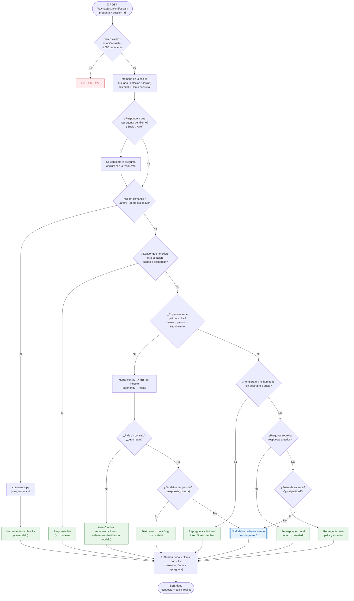
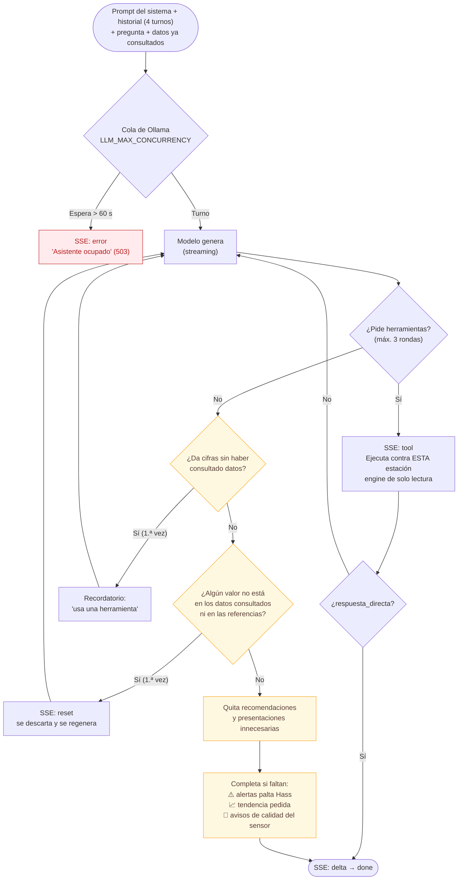

# Módulo Asistente IA (`app/assistant`)

> Documentación técnica del módulo, para quien lo mantenga o lo extienda.
> Documentación oficial del sistema:
> **[DEPLOY.md](../../DEPLOY.md)** (funcionalidades, flujos, despliegue) ·
> **[SERVICES.md](../../SERVICES.md)** (Ollama, PostgreSQL, monitoreo y fallas) ·
> **[.env.example](../../.env.example)** (variables `LLM_*`).

Chat conversacional por estación: **AgriSense, el asistente de paltas** (conoce el cultivo de
palta Hass). Responde con las mediciones reales de los 6 sensores de la estación consultada y
explica qué significan para el cultivo (riesgos), con lenguaje sencillo para agricultores o
técnico para ingenieros agrónomos. **Nunca da recomendaciones**: si le piden un consejo
("¿debo regar?", "¿qué fertilizante aplico?") lo aclara y muestra los datos de la estación;
si el modelo escribiera una recomendación, el código la quita antes de mostrar la respuesta.
Es un módulo autocontenido del monolito: se registra con dos líneas en
`app/main.py` y no modifica ninguna otra parte de la API.

**Idea central: el código decide y calcula; el modelo solo redacta.** Qué consultar, las fechas,
las estadísticas, las alertas y la verificación de cada cifra los hace Python. El modelo de
lenguaje (Ollama, `gemma4:e2b` en CPU) convierte esos datos en una respuesta natural, y en muchos
casos ni siquiera se le llama.

---

## Flujo de una pregunta

### 1. Qué camino toma cada pregunta

`chat/service.py` (`ChatService.ask_stream`) clasifica la pregunta **antes** de llamar al modelo.
Los caminos de la izquierda responden sin el modelo (más rápidos y siempre exactos).



🟩 Responde el código sin llamar al modelo · 🟦 Interviene el modelo · 🟥 Error de la petición

### 2. Bucle con el modelo y controles de calidad

Cuando interviene el modelo, cada respuesta pasa por controles **del código** antes de llegar al
usuario. Mientras no haya datos consultados, el texto no se transmite: podría contener un valor
inventado que hay que descartar.



🟨 Controles del código sobre la respuesta del modelo

**Eventos SSE que recibe la app**

| Evento | Cuándo | La app |
|---|---|---|
| `tool` | Se ejecuta una herramienta | Muestra "Consultando datos de la estación…" |
| `delta` | Llega un fragmento de texto | Lo agrega a la respuesta |
| `reset` | El texto mostrado se descarta (valor no respaldado o el modelo pidió datos) | Borra lo mostrado |
| `done` | Respuesta final, con `quick_replies` | Muestra los botones sugeridos |
| `error` | Asistente ocupado o modelo no disponible | Muestra el mensaje |

---

## Sensores

| Sensor (nombre para el modelo) | Código en BD | Unidad | Rango válido |
|---|---|---|---|
| `temperatura_ambiente` | `ambient_temperature` | °C | −10 a 50 |
| `humedad_ambiente` | `ambient_humidity` | % | 0 a 100 |
| `presion_atmosferica` | `atmospheric_pressure` | hPa | 500 a 1100 |
| `temperatura_suelo` | `soil_temperature` | °C | −10 a 60 |
| `humedad_suelo` | `soil_moisture` | % | 0 a 100 (0 exacto se avisa) |
| `ph_suelo` | `soil_ph` | pH | 0 a 14 |

Las lecturas fuera de rango (p. ej. −127 °C de una sonda desconectada) se descartan y se avisa.

## Herramientas (`tools/station_tools.py`)

Todas están **ligadas a la estación de la URL**: ninguna recibe la estación como parámetro.

| Herramienta | Para qué |
|---|---|
| `lecturas_actuales` | Última lectura de cada sensor (o de los pedidos) |
| `estadisticas_sensor` | Resumen de uno o varios sensores en un periodo |
| `diagnostico_palta` | Los 6 sensores de un periodo frente a los rangos de la palta Hass |

## Reportes por sensor

Cada sensor mide cada ~10 minutos (unas 144 lecturas por día). La herramienta
`estadisticas_sensor` resume cualquier periodo y el **código** (no el modelo) calcula:

| Dato | Ejemplo de pregunta |
|---|---|
| Máximo y mínimo con día y hora | "¿Qué día del mes hubo mayor temperatura?" → 35.6 °C el 12/09 13:55 |
| Día con promedio más alto / más bajo | "¿Qué día tuvo la temperatura promedio más alta?" → 06/09, 25.3 °C |
| Promedio, días con datos y resumen diario | "Dame un reporte de la temperatura de este mes" |
| Tendencia (sube / baja / estable) | "¿Cómo cambió el pH del 4 al 18 de septiembre?" |

Periodos: `hoy`, `ayer`, `ultimas_24_horas`, `ultimos_7_dias`, `ultimos_30_dias`,
`este_mes`, `mes_anterior` y `rango`. Las fechas escritas por el usuario
("septiembre", "del 10 al 18", "mes pasado", "última semana") las interpreta
`domain/dates.py`, en hora de Perú, y tienen prioridad sobre las que complete el modelo.

## Alertas para la palta Hass (solo informan)

`domain/avocado.py` evalúa **por código** cada resultado frente a los rangos de la palta
Hass. Solo cuando un valor está en exceso se entrega como `alertas_palta`: qué valor salió de
lo normal y qué riesgo implica, sin decir qué hacer. Con valores normales no hay alerta y la
respuesta es solo el dato:

| Sensor | Referencia | Alerta (informativa) |
|---|---|---|
| Temperatura ambiente | óptimo 20–25 °C | > 30 °C estrés por calor; ≥ 35 °C calor extremo; ≤ 2 °C helada |
| Humedad ambiente | 60–80 % | > 85 % promedio (hongos) |
| Temperatura del suelo | 18–25 °C | > 30 °C estrés de raíces |
| Humedad del suelo | 20–40 % (orientativo) | < 20 % seco; > 50 % encharcamiento / Phytophthora |
| pH del suelo | 5.5–6.5 | > 7.5 muy alcalino (clorosis); < 5.0 ácido |

Además: alerta combinada de calor con aire seco (DPV máximo > 2 kPa), el DPV como dato
técnico (`dpv`) y la etapa fenológica del mes. Las preguntas se entienden aunque tengan
errores de tipeo ("temperatrua", "promdio", "humdad del sulo", "setimbe").

## Secuencia de la conversación

`chat/planner.py` decide **por código** qué consultar antes de llamar al modelo, así el
modelo no puede responder "no hay datos" sin consultar ni pedir aclaraciones innecesarias:

| Pregunta | Consulta |
|---|---|
| "promedio de humedad de suelo del mes de setimbe" | `estadisticas_sensor` humedad del suelo, 01–30/09 (meses mal escritos se corrigen) |
| "cual es el promedio de humedad de suelo" (sin periodo) | mismo periodo de la consulta anterior; si no hay, últimos 7 días |
| "¿y el mínimo?", "¿y en agosto?" | mismos sensores de la consulta anterior |
| "¿la temperatura presentada es ambiental o de suelo?" | se responde con el contexto guardado, sin consultar |
| "última semana registrada" o periodo reciente sin datos | ventana anclada al último registro, con aviso (`periodo_ajustado`) |
| "¿cómo están mis paltas?", "¿debo regar hoy?" | `diagnostico_palta` |

La memoria (`chat/memory.py`) guarda los últimos 4 turnos y la última consulta (sensores y
fechas), que se describe en el prompt del sistema. Vive en el proceso: se pierde al reiniciar y
expira a los 30 min sin uso (ver [SERVICES.md §7](../../SERVICES.md#7-estado-en-memoria-y-escalamiento-redis)).
Las respuestas se entregan en texto plano (sin Markdown), que es como las muestra la app.

## Consultas rápidas (`chat/commands.py`)

Comandos que se resuelven sin interpretar con el modelo; la app los muestra en el panel ⚡
(`GET /chat/{code}/commands`, solo con los sensores que tiene la estación).

| Grupo | Comandos |
|---|---|
| Clima y resúmenes | `/ahora`, `/hoy`, `/ayer`, `/semana`, `/mes`, `/estado` |
| Por sensor | `/temp-aire`, `/temp-suelo`, `/hum-aire`, `/hum-suelo`, `/ph`, `/presion` + periodo |
| Valores puntuales | `/max`, `/min`, `/prom` + sensor + periodo |
| Cultivo | `/alertas`, `/diagnostico` |

## Rutas

Todas requieren `Authorization: Bearer <access_token>` de `/api/v1/user/login` (salvo `health`).
Tabla general de la API: [DEPLOY.md §4](../../DEPLOY.md#4-api-rest).

| Método | Ruta | Descripción |
|---|---|---|
| POST | `/api/v1/chat/{station_code}` | Respuesta completa en JSON |
| POST | `/api/v1/chat/{station_code}/stream` | Respuesta en streaming (SSE): `tool`, `delta`, `reset`, `done`, `error` |
| GET | `/api/v1/chat/{station_code}/commands` | Catálogo de consultas rápidas de la estación |
| DELETE | `/api/v1/chat/{station_code}/sessions/{session_id}` | Reinicia la conversación |
| GET | `/api/v1/assistant/health` | Base de datos y modelo disponibles (sin token) |

Petición: `{"question": "¿Cuál fue la temperatura máxima de ayer?", "session_id": "id-conversacion"}`

Errores: `401` token inválido o expirado · `404` estación inexistente ·
`422` pregunta vacía o mayor a 500 caracteres · `503` asistente ocupado o modelo no disponible.

## Estructura

```
app/assistant/
├── __init__.py        # expone assistant_router (lo único que importa app/main.py)
├── config.py          # AssistantSettings: LLM_*, CHAT_*, ASSISTANT_DB_* (todo con valores por defecto)
├── container.py       # arma las dependencias en la primera consulta y las libera al apagar
├── api/               # rutas, esquemas y validación del token
├── chat/
│   ├── service.py     # orquestador (diagramas 1 y 2)
│   ├── planner.py     # qué consultar antes del modelo
│   ├── commands.py    # consultas rápidas "/..."
│   ├── grounding.py   # verifica que cada cifra esté en los datos
│   ├── prompts.py     # prompt del sistema y plantillas fijas
│   └── memory.py      # historial por usuario, estación y sesión
├── llm/               # contrato LLMClient + implementación Ollama (cola de concurrencia)
├── tools/             # herramientas ligadas a una estación
├── domain/            # sensores, periodos, fechas y conocimiento agronómico de palta Hass
└── data/              # engine de solo lectura + consultas SQL
tests/assistant/       # tests sin BD ni modelo
scripts/assistant/     # chat en consola y evaluación con preguntas reales
```

## Principios de diseño

1. **Aislamiento por estación garantizado por código.** La estación sale de la URL;
   ninguna herramienta del modelo tiene parámetro de estación.
2. **El modelo nunca escribe SQL.** Elige sensor y periodo de listas cerradas; las
   consultas son parametrizadas y el engine del asistente es de solo lectura
   (`default_transaction_read_only`), con un pool propio separado del de la API.
3. **Las fechas las calcula el código** (`hoy`, `ayer`, `ultimos_7_dias`, `rango`…), en hora de Perú.
4. **Sin valores inventados.** Si el modelo da una medición o dice "no hay datos" sin consultar una herramienta,
   se le pide consultarla. Solo se aceptan cifras que estén en los datos consultados o en las referencias de palta Hass.
5. **Calidad de datos.** Se descartan lecturas imposibles y se avisa.
6. **Pensado para CPU.** Prompt corto, resultados compactos, `think` desactivado y cola con límite de concurrencia.
7. **Proveedor intercambiable.** Cambiar Ollama por otro servicio es una clase nueva que cumpla `LLMClient`.

## Autenticación

Valida el token con la `JWT_SECRET_KEY` y el `ALGORITHM` de `app/services/auth.py`
(no se duplican), con `HTTPBearer` para que Swagger muestre el campo de token.

## Configuración y producción

No tiene archivos propios: lee el mismo `.env` del backend y todo tiene valores por defecto.

| Tema | Dónde |
|---|---|
| Variables `LLM_*` y `TIMEZONE` | [.env.example](../../.env.example) (sección "Asistente IA") |
| Ollama, modelo, cola y recursos del servidor | [SERVICES.md §3.3](../../SERVICES.md#33-ollama-modelo-de-lenguaje) |
| Despliegue con Docker (descarga del modelo con `ollama-pull`) | [DEPLOY.md §8](../../DEPLOY.md#8-primer-despliegue) |
| Proxy sin buffering para `/stream` (`X-Accel-Buffering: no` ya se envía) | [SERVICES.md §3.5](../../SERVICES.md#35-proxy-https) |
| Varios workers o réplicas (`ConversationStore` sobre Redis) | [SERVICES.md §7](../../SERVICES.md#7-estado-en-memoria-y-escalamiento-redis) |

## Desarrollo

```powershell
.\venv\Scripts\python.exe -m pip install -r requirements-dev.txt

# Tests (no necesitan BD ni modelo)
.\venv\Scripts\python.exe -m pytest tests/assistant

# Chat en consola contra la BD real
.\venv\Scripts\python.exe -m scripts.assistant.chat_cli --station EST001-PALTAS

# Evaluación con preguntas reales contra la BD y el modelo (scripts/assistant/cases.json)
.\venv\Scripts\python.exe -m scripts.assistant.run_eval
.\venv\Scripts\python.exe -m scripts.assistant.run_eval --only A1,E1
.\venv\Scripts\python.exe -m scripts.assistant.run_eval --now "2026-11-15 10:00"   # simula otra fecha
```

La evaluación usa la hora real y **calcula las respuestas esperadas desde la BD en cada
ejecución** (`scripts/assistant/oracle.py`, con SQL propio, independiente del asistente).
Por eso sigue siendo válida cuando llegan datos nuevos, se rellenan datos atrasados o cambia
el mes: "¿máxima de ayer?" se compara con el dato real de ayer, y si un periodo no tiene
datos se exige que el asistente lo diga. Conviene correrla antes de cada despliegue, al cambiar
la versión de Ollama o el modelo, y una vez al mes; el criterio de paso a producción es ≥ 95 %
de aciertos. Para agregar un caso:

```json
{"id": "X1", "category": "…", "station": "EST002-PALTAS", "question": "¿Cuál fue la humedad del suelo mínima de ayer?",
 "expect_tool": "estadisticas_sensor", "expect_args": {"sensor": "humedad_suelo"},
 "expect_db": {"sensor": "humedad_suelo", "period": "ayer", "metrics": ["min"]}}
```
